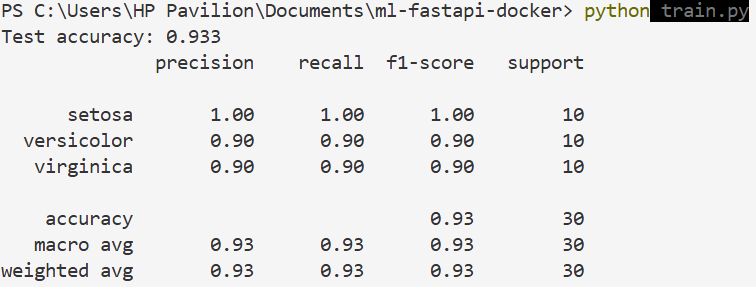
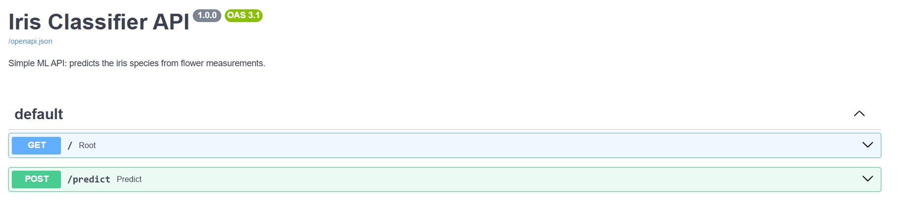
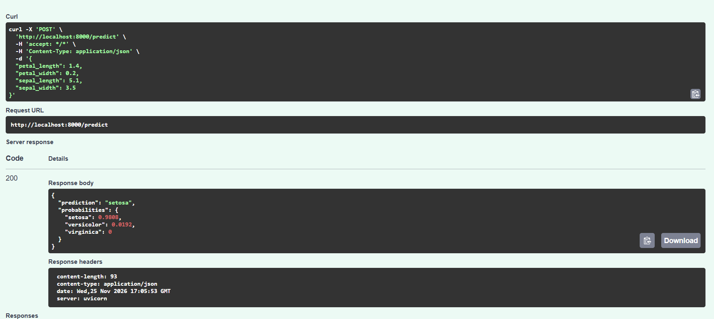
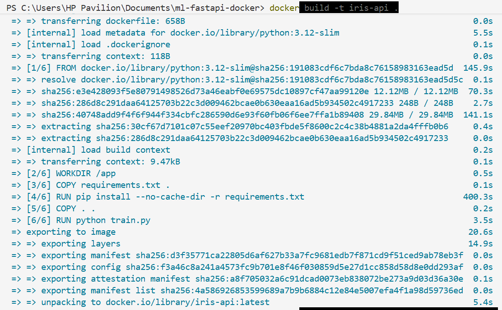
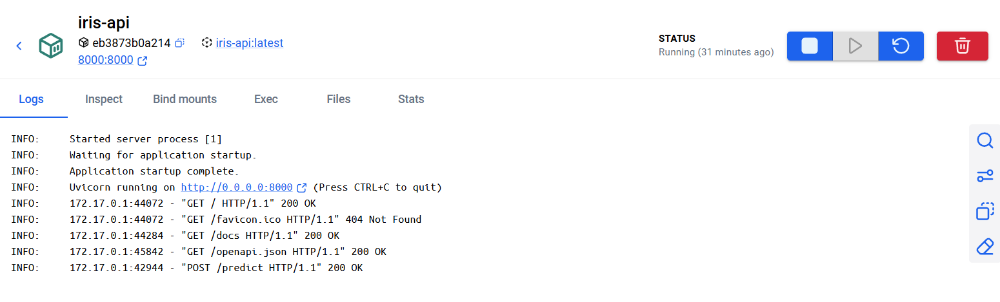
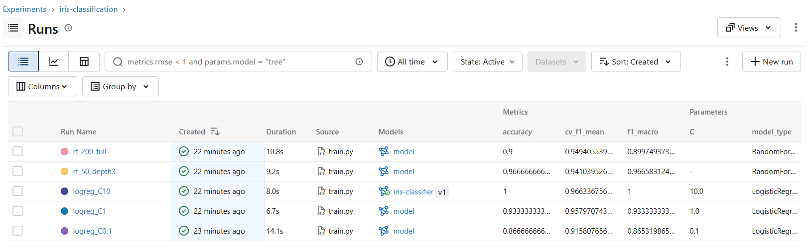
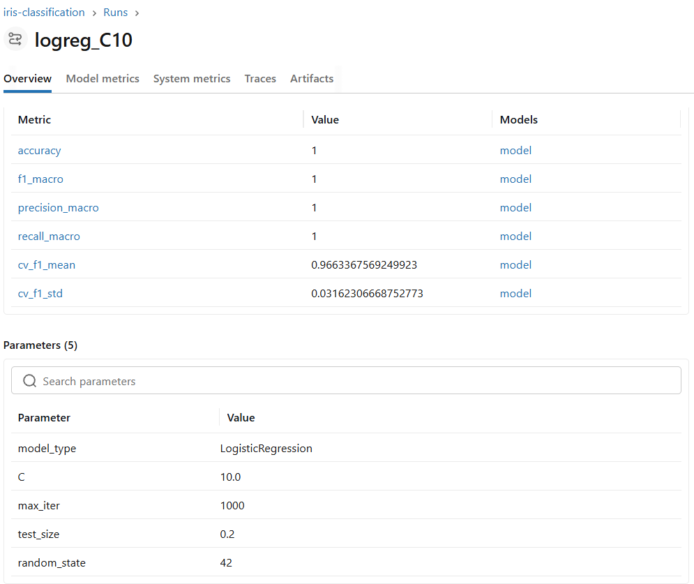
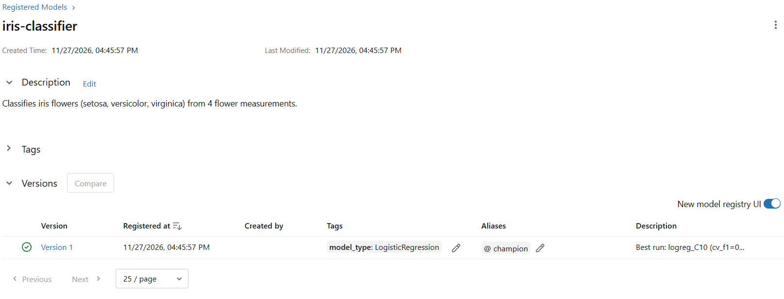
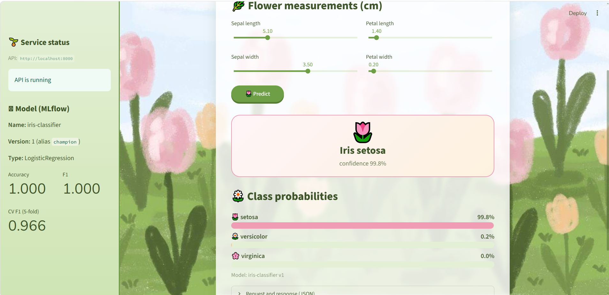

# ML System: FastAPI + Docker + Streamlit + MLflow

Iris species classifier extended from a basic API deployment (Practical Task 6) to a small
**ML system** with experiment tracking, a model registry, an API service and a user interface (SIS-3).

- **Dataset:** Iris (scikit-learn): 150 flowers, 4 features, 3 classes.
- **Task:** multiclass classification: `setosa`, `versicolor`, `virginica`.
- **Models compared:** Logistic Regression (C = 0.1, 1, 10) and Random Forest (2 settings), each with `StandardScaler` in a `Pipeline`.
- **Model selection:** best 5-fold cross-validation F1 on the training set (then test F1).

## Architecture

```
            train.py
               │  logs params, metrics, artifacts
               ▼
   ┌────────────────────────┐       mlflow ui → http://localhost:5000
   │  MLflow                │       (experiments, runs, Model Registry)
   │  • Experiment          │
   │  • Model Registry:     │
   │    iris-classifier vN  │
   │    alias "champion"    │
   └──────────┬─────────────┘
              │ best model exported → model.joblib + model_info.json
              ▼
   ┌────────────────────────┐   HTTP (JSON)   ┌────────────────────────┐
   │  FastAPI  :8000        │ ◄────────────── │  Streamlit  :8501      │
   │  /predict, /model-info │ ──────────────► │  sliders + chart       │
   └────────────────────────┘                 └────────────────────────┘
        Docker container                           Docker container
                  └──────── docker-compose.yml ────────┘
```

## Project structure

```
ml-fastapi-docker/
├── train.py               # training + MLflow tracking + Model Registry
├── main.py                # FastAPI app (GET /, GET /model-info, POST /predict)
├── model.joblib           # best model exported by train.py
├── model_info.json        # registered model name, version, run id, metrics
├── requirements.txt       # API dependencies
├── requirements-train.txt # training dependencies (MLflow)
├── Dockerfile             # API container
├── docker-compose.yml     # runs API + frontend together
├── frontend/
│   ├── app.py             # Streamlit UI (garden design)
│   ├── .streamlit/config.toml  # green theme
│   ├── assets/garden.jpg  # background picture
│   ├── requirements.txt
│   └── Dockerfile         # frontend container
├── mlflow.db              # MLflow tracking + registry database (created by train.py)
├── mlruns/                # MLflow artifacts (created by train.py)
└── screenshots/
```

## MLflow integration

### Experiment tracking

`train.py` creates the experiment **`iris-classification`** and runs one MLflow run per candidate model. Each run logs:

| What | Logged items |
|---|---|
| **Parameters** | `model_type`, hyperparameters (`C`, `max_iter` / `n_estimators`, `max_depth`), `test_size`, `random_state` |
| **Metrics** | `accuracy`, `f1_macro`, `precision_macro`, `recall_macro`, `cv_f1_mean`, `cv_f1_std` |
| **Artifacts** | `model_file/model.joblib` (saved model file), `reports/classification_report.txt`, MLflow model `model/` with signature and input example |

### Model Registry

- The best run is registered as **`iris-classifier`**.
- Every new training creates a **new version** (1, 2, 3, …).
- The newest best version gets the alias **`champion`**, a description and a `model_type` tag.
- The registered model can be loaded with `mlflow.sklearn.load_model("models:/iris-classifier@champion")`.

The API serves the same best model, exported to `model.joblib`. `GET /model-info` shows which registered model and version are being served.

---

## How to run

### 1. Train models and log them to MLflow

```bash
pip install -r requirements-train.txt
python train.py
```

Expected output (end):

```
Best run: logreg_C10 (run_id=...)
Registered model: iris-classifier, version 1, alias 'champion'
Saved model.joblib and model_info.json
```

### 2. Open the MLflow UI

```bash
mlflow ui --backend-store-uri sqlite:///mlflow.db
```

Open http://localhost:5000:

- **Experiments → iris-classification**: all runs with parameters and metrics (you can sort and compare runs).
- Click a run → **Parameters**, **Metrics**, **Artifacts**.
- **Models → iris-classifier**: versions, alias `champion`.

### 3. Run the API

```bash
pip install -r requirements.txt
uvicorn main:app --reload
```

- http://localhost:8000/docs → Swagger UI
- http://localhost:8000/model-info → served model name and version

### 4. Run the Streamlit frontend

In a **second** terminal (the API must be running):

```bash
cd frontend
pip install -r requirements.txt
streamlit run app.py
```

Run it from the `frontend` folder, so Streamlit picks up the garden theme from `frontend/.streamlit/config.toml`.

Open http://localhost:8501: set the measurements with sliders → **Predict** → species, confidence and probability bars. The sidebar shows the API status and the registered model version.

**Design:** garden theme. The page background is a tulip garden picture (`frontend/assets/garden.jpg`), the colors are taken from it: leaf green for the buttons and sliders, pink, peach and lilac for the three iris species.

### 5. Run everything with Docker Compose

Run `python train.py` first, so `model.joblib` and `model_info.json` exist. Then:

```bash
docker compose up --build
```

- Frontend: http://localhost:8501
- API: http://localhost:8000/docs

Stop with `Ctrl + C`, then `docker compose down`.

> Inside Docker the frontend reaches the API at `http://api:8000` (the service name from `docker-compose.yml`), not `localhost`.

---

## Screenshots

### Practical Task 6

#### Model training


#### Swagger UI (`/docs`)


#### Prediction via `POST /predict`


#### Docker build


#### Running container (Docker Desktop)


### SIS-3

#### MLflow: experiment runs


#### MLflow: run details (parameters, metrics, artifacts)


#### MLflow: Model Registry


#### Streamlit frontend


#### Docker Compose

